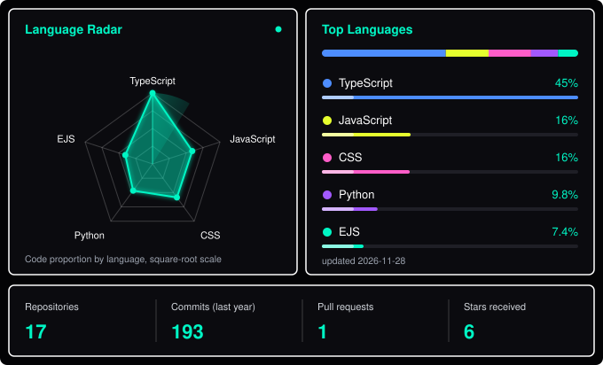

  

## About Me

I'm **Shashank Kumar**, a B.Tech CSE student at **Bennett University** (`CGPA 8.55`) and Full Stack Intern at **BAOIAM Innovations**, focused on building scalable MERN & TypeScript systems with clean backend architecture and AI integration.

- 🚀 **Building now:** **FITFORGE** (distributed microservices fitness platform) & **NyayaNexus** (multilingual legal AI)
- 💼 **Experience:** Full Stack Intern @ **BAOIAM Innovations** · Ex-Frontend Intern @ **Zidio Development** (`React` + `D3.js`)
- 🧠 **Problem Solving:** **228+ DSA problems** in C++ (LeetCode rating **1420**) · Strong in OOP, OS, DBMS & Computer Networks
- 🤝 **Open to:** **Full Stack / Backend / SWE Internships & Placement Roles**
- 📄 **Résumé:** [View / Download PDF](./Shashank_Kumar_Resume.pdf)
- 💬 Any questions? Feel free to reach out!

## Languages and activity

  

  

## Featured Projects

<table>
<tr>
<td width="50%" valign="top">

**FITFORGE** · *Microservices Platform* 
Enterprise fitness & nutrition intelligence platform with an API Gateway, independently containerized services, Swagger docs, and interactive `D3.js` analytics. 
`TypeScript` `React 19` `Node.js` `Docker` `D3.js` 
[Repository →](https://github.com/Shashank520104/FITFORGE)

</td>
<td width="50%" valign="top">

**NyayaNexus** · *Lead Architect & Backend* 
Multilingual governance & legal-assistance AI chatbot following strict MVC architecture, Gemini API orchestration, and anti-hallucination guardrails. 
`JavaScript` `Node.js` `Express` `Gemini API` `MVC` 
[Repository →](https://github.com/Shashank520104/Nayaya_Nexus)

</td>
</tr>
<tr>
<td width="50%" valign="top">

**Shaurya AI** · *AI Career & ATS Analyzer* 
Multi-mode conversational career assistant and PDF resume ATS analyzer built with React, Express, and streamed Google Gemini responses. 
`React` `Node.js` `Express` `Gemini API` 
[Repository →](https://github.com/Shashank520104/ai-text-assistant)

</td>
<td width="50%" valign="top">

**Airbnb Fullstack Clone** · *Booking Platform* 
Full-stack property exploration and booking web app featuring destination, date-range, and category filtering with a typed API backend. 
`Next.js` `TypeScript` `FastAPI` `SQLAlchemy` 
[Repository →](https://github.com/Shashank520104/airbnb-fullstack-clone)

</td>
</tr>
</table>

  Also shipped: <a href="https://github.com/Shashank520104/Cognix"><b>Cognix</b></a> (Mood-Adaptive Learning Platform) · <a href="https://github.com/Shashank520104/Backend-cricket-game"><b>Backend-cricket-game</b></a> · <a href="https://github.com/Shashank520104/Cognifyz"><b>Cognifyz Internship</b></a>

## Tech Stack

## Contacts

  

